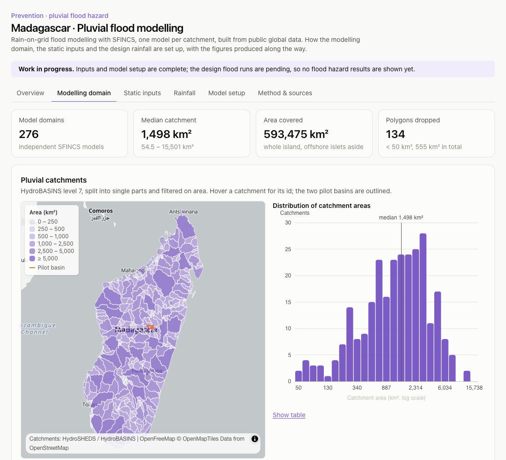

# Madagascar · Pluvial flood modelling

**[▶ Open the site](https://alvaroprida.github.io/madagascar-pluvial-flood/)**

[](https://github.com/alvaroprida/madagascar-pluvial-flood/actions/workflows/deploy-pages.yml)

Rain-on-grid (pluvial) flood modelling for Madagascar with **SFINCS**, one model per catchment, built
from public global datasets. This site documents how the inputs are set up and processed, with the
figures the modelling pipeline produces along the way.



> **Work in progress.** Inputs and model setup are complete; the design flood runs are pending, so no
> flood hazard results are shown yet. Not an official hazard map.

## What the site shows

| Tab | Content |
|---|---|
| **Overview** | Purpose, workflow and status |
| **Modelling domain** | The 276 HydroBASINS catchments used as independent model domains (interactive map) and the distribution of their areas |
| **Static inputs** | FABDEM topography, Copernicus land cover, GCN250 curve number and SoilGrids soil groups: how each is fetched per basin, national overviews, and QC figures for two pilot basins |
| **Rainfall** | GPM IMERG daily rainfall split into **tropical-cyclone, non-cyclone and total** rainfall using IBTrACS best tracks: cyclone catalogue and tracks, maps and seasonal cycle of each population, design depths by return period, and the design storm of a pilot basin |
| **Model setup** | How each SFINCS model is built, with the setup check of the pilot basins |
| **Method & sources** | Assumptions, limitations, data licences and references |

## How it is built

The modelling pipeline (Python: rasterio, xarray, geopandas, HydroMT-SFINCS) lives in a separate
private repository. It exports the figures and summary data in [`web/public/data/`](web/public/data);
this repository only holds that output and the site that displays it.

The site is a static React + TypeScript app (Vite, Tailwind, ECharts, MapLibre), deployed to GitHub
Pages by [`deploy-pages.yml`](.github/workflows/deploy-pages.yml) on every push to `main`.

```bash
cd web
npm ci
npm run dev       # local preview
npm run build     # static build in web/dist
```

## Data and licences

Figures and data derive from FABDEM (CC BY-NC-SA 4.0, **non-commercial**), Copernicus Global Land
Cover, GCN250 (CC BY 4.0), SoilGrids (CC BY 4.0), HydroBASINS, GPM IMERG (NASA) and IBTrACS (NOAA);
full references on the *Method & sources* tab. Basemaps © OpenStreetMap contributors, OpenFreeMap.

Site code: MIT licence (see [LICENSE](LICENSE)). Data and figures follow the licences of their sources.
